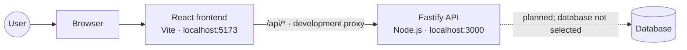
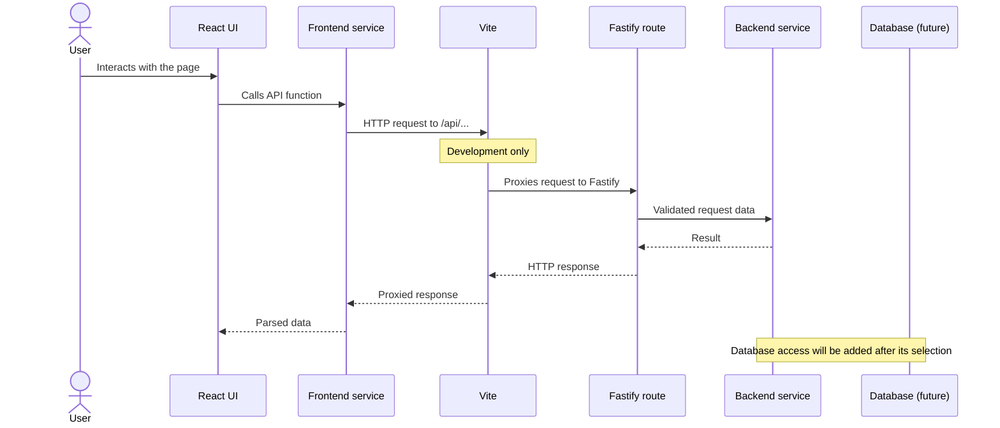

# System architecture

## Overview

Yboost B2 is split into independently installable frontend and backend
applications. Database resources are kept separate so a database engine can
be selected without coupling them to either application prematurely.

The frontend and backend can run directly with Node.js or in separate Docker
containers managed by [`docker-compose.yml`](../docker-compose.yml). In either
mode, Vite proxies `/api` requests to Fastify. In Compose mode, the proxy
targets the backend service by its Compose service name.
The database connection and persistence layer have not been selected or
implemented yet.

## Repository structure

This diagram shows the main application, infrastructure, and documentation
files. Dependency directories and generated build output are omitted.

```mermaid
flowchart TD
    Root["Yboost B2 repository"]
    Root --> Frontend["frontend/ · React, Vite, Tailwind"]
    Root --> Backend["backend/ · Node.js, Fastify"]
    Root --> Database["database/ · migrations, seeds"]
    Root --> Docs["docs/ · developer documentation"]
    Root --> Github[".github/workflows/ · CI and PR policy"]
    Root --> Compose["docker-compose.yml"]
    Root --> Ignore[".gitignore"]
    Root --> Readme["README.md"]

    Frontend --> FPublic["public/"]
    Frontend --> FSrc["src/"]
    Frontend --> FPackage["package.json · package-lock.json"]
    Frontend --> FDocker["Dockerfile · .dockerignore"]
    FSrc --> FAssets["assets/"]
    FSrc --> FComponents["components/"]
    FSrc --> FHooks["hooks/"]
    FSrc --> FPages["pages/"]
    FSrc --> FServices["services/"]
    FSrc --> FStyles["styles/"]

    Backend --> BSrc["src/"]
    Backend --> BTests["tests/"]
    Backend --> BPackage["package.json · package-lock.json"]
    Backend --> BDocker["Dockerfile · .dockerignore"]
    BSrc --> BConfig["config/"]
    BSrc --> BPlugins["plugins/"]
    BSrc --> BRoutes["routes/"]
    BSrc --> BSchemas["schemas/"]
    BSrc --> BServices["services/"]

    Docs --> Architecture["architecture.md"]
    Docs --> DevSetup["development-setup.md"]
    Docs --> Coding["coding-standards.md"]
    Docs --> Testing["testing-and-quality.md"]
    Docs --> GitWorkflow["git-workflow.md"]
    Docs --> ADR["ADR/"]
```

## Application boundaries

### Frontend

The frontend lives in [`frontend/`](../frontend/) and is built with React,
TypeScript, Vite, and Tailwind CSS.

- `src/pages/` contains page-level views and the application entry page.
- `src/components/` contains reusable UI components.
- `src/hooks/` contains reusable React hooks.
- `src/services/` contains API communication.
- `src/styles/` contains global styles and Tailwind entry styles.
- `src/assets/` contains imported images, fonts, and other static assets.
- `public/` contains static files served without importing them in code.

Keep API calls in services rather than embedding request details throughout
the UI. Components should focus on rendering and user interaction.

### Backend

The backend lives in [`backend/`](../backend/) and uses Node.js with Fastify, in TypeScript.

- `src/server.ts` loads configuration and starts the HTTP server.
- `src/app.ts` assembles the Fastify application and registers plugins/routes.
- `src/config/` validates and exposes runtime configuration.
- `src/plugins/` contains reusable Fastify plugins.
- `src/routes/` defines HTTP endpoints and delegates business work.
- `src/schemas/` holds request and response validation schemas.
- `src/services/` contains business logic independent of HTTP details.
- `tests/` contains automated backend tests.

Keep route handlers focused on HTTP concerns. Put reusable business logic in
services and validate external input at the API boundary.

### Database

[`database/`](../database/) is reserved for schema migrations and seed data.
The database engine, data-access library, and connection strategy remain
undecided. Record those choices in a new ADR before implementing them.

## Request flow

1. A React page or component calls a function from `frontend/src/services/`.
2. The service makes an HTTP request to `/api/...`.
3. Vite forwards that request to the Fastify server during development.
4. A Fastify route validates the request, calls the relevant service, and
   returns an HTTP response.
5. Once a database is selected, backend services will access it through the
   project's chosen data-access layer.

## Architecture decisions

See the [ADR index](./ADR/) and the current decisions:

- [ADR 0001: Frontend stack](./ADR/0001-frontend-stack.md)
- [ADR 0002: Backend stack](./ADR/0002-backend-stack.md)
