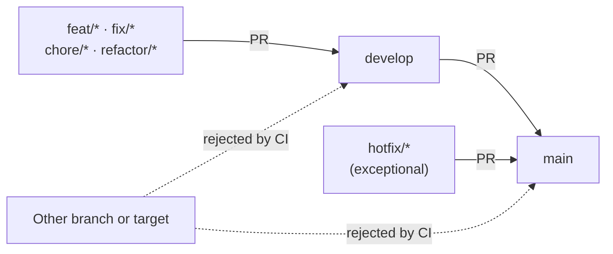

# Git workflow

Use this workflow to keep changes focused and straightforward to review.

## Branches and commits

- Create a short-lived branch using one of these prefixes:
  `feat/`, `fix/`, `chore/`, or `refactor/` (`refractor/` is also accepted).
- Keep commits focused on one logical change.
- Use Conventional Commit subjects, with a lowercase description and no final
  period. Subjects must be at most 72 characters:
  `feat(frontend): add dashboard`.
- Allowed types are `feat`, `fix`, `chore`, `refactor`, `refractor`, `docs`,
  `test`, `build`, `ci`, `perf`, `style`, and `revert`. A scope is optional.
- Do not commit `.env` files, credentials, `node_modules/`, or build output.

## Pull request policy

The GitHub Actions workflow rejects pull requests unless they follow this
branch flow:

| Source branch | Target branch | Allowed |
| --- | --- | --- |
| `feat/*`, `fix/*`, `chore/*`, `refactor/*`, or `refractor/*` | `develop` | Yes |
| `develop` | `main` | Yes |
| `hotfix/*` | `main` | Yes, for exceptional urgent fixes |
| Any other source/target combination | Any | No |

Every non-merge commit in a pull request must follow the required commit
subject format. The CI workflow also requires a successful frontend build and
backend test run.

To make these checks mandatory, configure GitHub branch protection or rulesets
for `develop` and `main`:

1. Require pull requests before merging and require the status checks
   **Validate source and target branches**, **Validate commit messages**,
   **Frontend build**, and **Backend tests**.
2. Require the pull request to be up to date before merging.
3. On `main`, require the source/target policy above to pass; this permits only
   `develop` or the emergency `hotfix/*` branches.
4. Restrict direct pushes to `main` and `develop` so changes cannot bypass
   pull request checks.

GitHub repository settings are required in addition to these workflow files;
workflow files alone cannot prevent direct pushes or make status checks
mandatory.

## Before opening a pull request

- Run the relevant commands from [Testing and quality](./testing-and-quality.md).
- Review the diff and remove unrelated changes or temporary files.
- Update the README or relevant guide if setup, commands, or behavior changed.
- Explain the motivation, implementation, and test results in the pull request.

## Architecture changes

When introducing or changing a major technology or boundary, add an
Architecture Decision Record in [`ADR/`](./ADR/) and link it from the
[architecture guide](./architecture.md). Use the existing ADRs as examples.
