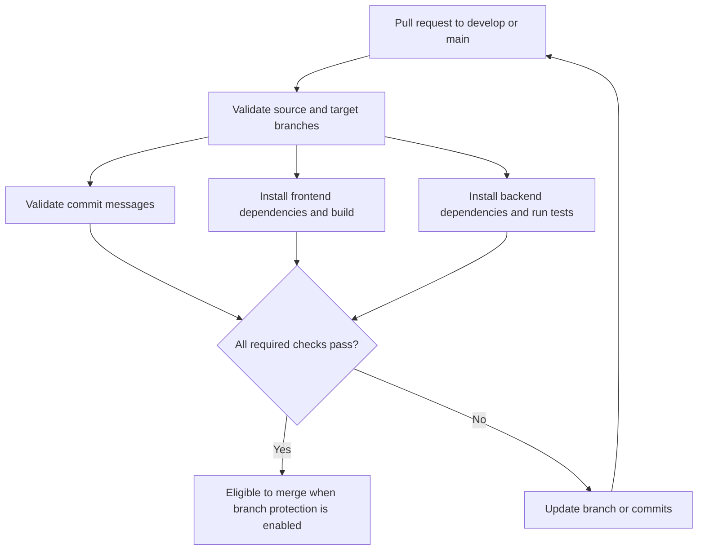

# Testing and quality checks

Run the relevant checks before requesting review. Run commands from the
repository root unless noted otherwise.

## Continuous integration

GitHub Actions runs the [CI workflow](../.github/workflows/ci.yml) for pull
requests targeting `develop` or `main` and for pushes to those branches. It
installs each application's locked dependencies, builds the frontend, and
runs the backend tests.

The [pull request policy workflow](../.github/workflows/pull-request-policy.yml)
checks that source and target branches follow the allowed
[Git workflow](./git-workflow.md#pull-request-policy), then validates all
non-merge commit subjects. A failed check blocks merging when branch
protection is configured to require the status checks.



## Current checks

### Frontend

Create a production build to catch compilation and bundling errors:

```sh
npm --prefix frontend run build
```

### Backend

Run the Node.js test suite:

```sh
npm --prefix backend test
```

The backend tests use Node's built-in test runner and Fastify's request
injection. The current health endpoint test is in
[`backend/tests/health.test.js`](../backend/tests/health.test.js).

## Expectations for changes

- Add or update tests when changing API behavior or business logic.
- For UI changes, verify the production build and manually check the affected
  page in the browser at common viewport sizes.
- For API changes, test expected responses and relevant invalid-input or
  failure cases.
- Run both checks when a change affects the frontend/backend integration.
- Include any manual verification steps that cannot be automated in the pull
  request description.

Linting and formatting commands are not configured yet. Add them as
application scripts when the project adopts the corresponding tools.
